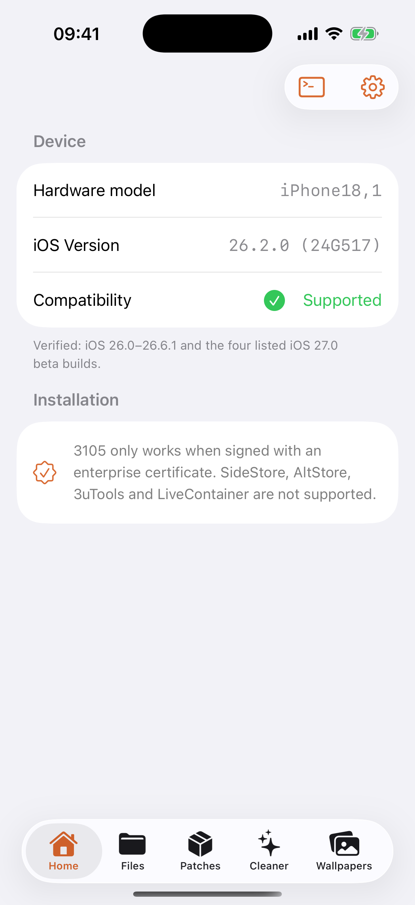
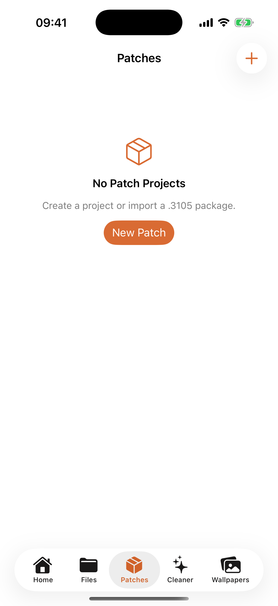
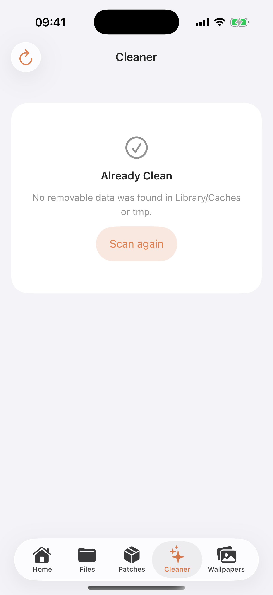

<p align="center">
  
</p>

<h1 align="center">3105</h1>

<p align="center">
  A native iOS workspace for app-container files, portable patches, limited cleanup, and PosterBoard wallpaper packages.
</p>

<p align="center">
  
  
  
  
</p>

<p align="center">
  <a href="README.vi.md">Tiếng Việt</a> ·
  <a href="docs/PATCH_GUIDE.md">Patch guide</a> ·
  <a href="#compatibility">Compatibility</a> ·
  <a href="#license">License</a>
</p>

> [!WARNING]
> 3105 is research software for personal device management. Keep a backup and use it only on devices and data you own. Simulator screenshots demonstrate UI only; they do not verify device-level access.

## Preview

<p align="center">
  
  &nbsp;
  
  &nbsp;
  
</p>

## What's new in 1.1.1

- **All iOS versions** — the verified-range and beta-build whitelist is gone. Every iOS version that can install the app (deployment target iOS 16.0) is enabled, including iOS 27 release builds, later betas, and future majors.
- **No hard abort on unknown builds** — `offsets_init` falls back to the newest known offsets and logs an `offsets: ... unverified` hint instead of terminating the exploit.
- **Forward-compatible kernel detection** — iOS 27+ builds are accepted even when the kernel's second-word magic differs from iOS 26.
- **Wallpaper Lab everywhere** — the wallpaper tab is no longer limited to iOS 17/18/26/27.

See [Compatibility](#compatibility) for the offset caveat on unverified releases.

## What's new in 1.1.0

- **Broader iOS support** — verified range now includes iOS 17.0–17.7.x (kernel exploit), iOS 18.0–18.7.1 (kernel exploit), iOS 26.0–26.6.1 and iOS 27 Developer Beta 1–4 / Public Beta 1–2.
- **Wrong-password feedback** — importing a `.3105` patch with an incorrect password now shows "Incorrect password" instead of failing silently.
- **Onboarding for reinstalls** — onboarding reappears after overwriting the app with the same version, so fresh and overwritten installs both see the guided setup.

See the complete [Patch workspace guide](docs/PATCH_GUIDE.md).

## What's new in 1.0.1

- **Patch workspace v2** — build patches as a normal bundle-based directory tree under `On My iPhone/3105/Patches`; Apply and Export synchronize the workspace automatically.
- **Safer recovery** — original files are journaled before writes; Restore puts existing files back, removes files introduced by the patch, and removes patch-created directories once empty.
- **More capable Files tab** — independent tabs, preserved folder position, multi-selection, ZIP creation and extraction, plus a denser and more consistent grouped layout.
- **Responsive navigation** — iPad split-view and landscape support, optional Cleaner/Wallpaper tabs, stable search fields, and refined icon/row sizing.
- **Wallpaper guidance** — corrected PosterBoard activation steps, including the iOS 27 Collections prerequisite.

See the complete [Patch workspace guide](docs/PATCH_GUIDE.md).

## Highlights

- **App Data Browser** — resolves volatile container UUIDs to stable app bundle identifiers and exposes a native file workspace.
- **File operations** — search, preview, share, import multiple files, copy, move, paste, rename, delete, create files and folders, make ZIP archives, and safely handle name conflicts.
- **Portable `.3105` patches** — bundle-based rules survive container-ID changes between devices; projects may include files or folders, support optional password protection, and can be imported from Files or a secure website link.
- **Limited Cleaner** — scans only each app's `Library/Caches` and `tmp`, sorts recoverable size in either direction, supports bulk selection, and requires confirmation before deletion.
- **Wallpaper Lab** — imports `.tendies` packages, validates payloads, journals installed items, and resets only content installed by 3105.
- **No jailbreak installation** — 3105 does not install a persistent jailbreak, bootstrap, or daemon and does not inject code into third-party apps. Because it still uses device exploits and can modify app data, no universal guarantee can be made against every app's integrity or jailbreak-detection policy.
- **Localized interface** — English, Vietnamese, and Simplified Chinese.

## Compatibility

3105 no longer gates device-level features by iOS version or build. Every iOS version that can install the app is enabled:

| Item | Status |
| --- | --- |
| Supported versions | All iOS versions 16.0 and later (release, beta, and future majors) |
| Build whitelist | Removed — no beta build list |
| Deployment target | iOS 16.0 |
| Offset fallback | iOS 26.0 baseline for unverified 26.1+; iOS 17.0 baseline for below 17.0 |

> [!NOTE]
> The kernel exploit still needs offsets that match the running kernel. On an iOS version not covered by the offset table the exploit may fail; the app now logs an `offsets: ... unverified` hint and falls back to the newest known offsets instead of aborting. A failed exploit attempt may restart the app.

## Installation notes

- Device functionality requires signing with an **enterprise certificate**.
- SideStore, AltStore, 3uTools, and LiveContainer are not supported installation paths.
- The target bundle identifier is intentionally `com.apple.mobile.MobileHouseArrest`; changing it can break the MHA-C2 app-container workflow.
- The source tree does not contain certificates, provisioning profiles, signed applications, or IPA files; release assets may provide an unsigned IPA.

## Build, sign & install

`scripts/` contains the full toolchain wiring. It deliberately contains **no** certificates, profiles, passwords, or team IDs — supply your own, on your own Mac:

```bash
# 1. Build an unsigned IPA (Xcode + Command Line Tools required)
./scripts/build-unsigned-ipa.sh

# 2. Import YOUR OWN enterprise certificate, then list the identity
security import /path/to/enterprise.p12 -k ~/Library/Keychains/login.keychain-db -P 'YOUR_P12_PASSWORD' -T /usr/bin/codesign
security find-identity -v -p codesigning

# 3. Re-sign with an enterprise profile covering com.apple.mobile.MobileHouseArrest
./scripts/resign-ipa.sh 3105-unsigned.ipa "iPhone Distribution: Your Enterprise" /path/to/profile.mobileprovision 3105-signed.ipa

# 4. Install onto a USB-connected device (Apple Configurator or libimobiledevice)
./scripts/install-ipa.sh 3105-signed.ipa
```

For `Product > Archive > Distribute App (Enterprise)`, copy `scripts/ExportOptions-Enterprise.plist` and replace `YOUR_TEAM_ID` / `YOUR_ENTERPRISE_PROFILE_NAME`. For enterprise OTA or MDM delivery, host the **signed** IPA plus an `itms-services` manifest over HTTPS (or push it through your MDM); an unsigned IPA cannot be installed.

> [!CAUTION]
> Use only an enterprise certificate you are authorized to use. Never commit `.p12`, passwords, or `.mobileprovision` files, and never paste private keys into chats or issue trackers. `.gitignore` already excludes signing material and build artifacts. `com.apple.mobile.MobileHouseArrest` is an Apple-reserved identifier, so a standard developer account usually cannot create a matching App ID — that is why the project distributes an unsigned IPA for re-signing instead of a ready-to-install build.

## Without a Mac

> ภาษาไทย: [docs/QUICKSTART.th.md](docs/QUICKSTART.th.md) — คู่มือแบบคลิกทีละขั้นตอน (สร้าง repo → push → โหลด IPA → เซ็น → ติดตั้ง)

An enterprise certificate and a provisioning profile covering `com.apple.mobile.MobileHouseArrest` are still required — no workaround removes that. The Mac itself is optional:

1. **Build in CI** — `.github/workflows/build-unsigned-ipa.yml` runs on a GitHub-hosted `macos-latest` runner (free for public repos; private repos use your plan's minutes). Push the repo, open **Actions > Build unsigned IPA > Run workflow**, then download the `3105-unsigned-ipa` artifact. No certificate is needed for this step (`CODE_SIGNING_ALLOWED=NO`).
2. **Sign on the iPhone with ESign** — copy the unsigned IPA to the device (Files / AirDrop), import your `.p12` + `.mobileprovision` into ESign, then sign and install. This is the path the project's release notes use and it needs no computer at all.
3. **Sign on Windows/Linux with zsign** — `zhlynn/zsign` re-signs an IPA without Xcode:

   ```powershell
   .\scripts\resign-windows-zsign.ps1 -Ipa .\3105-unsigned.ipa `
     -P12 .\enterprise.p12 -P12Password 'YOUR_PASSWORD' `
     -MobileProvision .\profile.mobileprovision
   ```

   Copy `3105-signed.ipa` to the device and install it with ESign, or serve it over HTTPS with an `itms-services` manifest / push it through MDM. Installation from Windows still needs one of these paths (3uTools is not a supported installer for 3105).

### Push to GitHub from Windows (no Mac)

The project is already initialized as a Git repository with a local commit. You only supply the URL of **your own** repository — the script never handles or prints a token.

1. Create a **new empty repository** on GitHub. Do **not** tick "Add a README", a license, or a `.gitignore` (an empty remote avoids a rejected first push), and leave the default branch as `main`.
2. From the project root, in **Git Bash** (or WSL / macOS Terminal), run:

   ```bash
   ./scripts/push-to-github.sh https://github.com/<user>/<repo>.git
   ```

   Authentication happens in Git Credential Manager / your normal `git` credential prompt. If you use a Personal Access Token, paste it **only** into that prompt — never into a chat, issue, or file. The script stages and commits any remaining changes, verifies that no `.p12`, `.mobileprovision`, `.env`, or similar secret is tracked, checks that the CI workflow is included, forces the `main` branch, sets `origin`, and pushes.

   If a non-interactive shell reports `could not read Username` / `Authentication failed`, run `scripts\push-now.cmd` from Windows Explorer or `cmd` so Git Credential Manager can open its sign-in window. The launcher is self-contained: it has a default remote (overridable with the first argument), finds the project folder even when the `.cmd` was opened from a copied/downloaded location, initializes Git and commits if needed, sets `origin`, pushes `main`, and prints the Actions/artifact steps. No token is stored by the script.
3. Pushing to `main` triggers **Build unsigned IPA** automatically; you can also start it manually under **Actions > Build unsigned IPA > Run workflow**. A GitHub-hosted `macos-latest` runner builds `3105-unsigned.ipa` and uploads it as the `3105-unsigned-ipa` artifact (retained 14 days).
4. Download and unzip the artifact. It contains `3105-unsigned.ipa`, which is **unsigned** — sign it with your own authorized enterprise certificate and matching provisioning profile (ESign on-device, or `scripts/resign-windows-zsign.ps1`) before installing via ESign, enterprise OTA / MDM, or Apple Configurator.

If the first push is rejected because the remote already has commits, run `git pull --rebase origin main && git push -u origin main`, or recreate the repository empty.

To have CI produce a *signed* IPA, add a step after the build that decodes secrets (`P12_BASE64`, `P12_PASSWORD`, `MOBILEPROVISION_BASE64`) into `RUNNER_TEMP`, imports the certificate into a temporary keychain, and calls `scripts/resign-ipa.sh`. Only do this with a certificate your team owns and is licensed to distribute; never commit signing material, and remember fork pull requests receive no secrets.

Rented cloud Macs (MacInCloud, MacStadium, AWS EC2 Mac) are a last resort if you need the full Xcode GUI; this project does not require it.

## Project layout

```text
3105/
├── ThreeOneOSFive/          # SwiftUI app, helpers, native bridges, localizations
├── ThreeOneOSFive.xcodeproj # Xcode project and 3105 scheme
├── scripts/                 # unsigned IPA build, re-sign (macOS/Windows), install, export options, GitHub push
├── .github/workflows/       # macOS-runner CI build for an unsigned IPA
└── docs/images/             # Repository artwork and current UI previews
```

## Security and responsible use

Do not publish logs, app containers, cookies, account databases, or patch payloads containing personal data. Report security-sensitive issues privately to the maintainer.

## Credits

3105 is developed and designed by [YangJiii](https://x.com/duongduong0908).

Special thanks to [0xjohnny](https://x.com/0xjohnny) for [FilzaSlop](https://github.com/0xjohnnydev/FilzaSlop) and related research:

- [MobileHouseArrest-PoC](https://github.com/0xjohnnydev/MobileHouseArrest-PoC) — ContainerManager identity-trust bug
- [Geod-MCM-PoC](https://github.com/0xjohnnydev/Geod-MCM-PoC) — `geod` MobileContainerManager `partDomain` traversal
- [InstallCoordination-PoC](https://github.com/0xjohnnydev/InstallCoordination-PoC) — persisted-state and final-symlink chain
- [CFPrefsZeroFile-PoC](https://github.com/0xjohnnydev/CFPrefsZeroFile-PoC) — `cfprefsd` zero-file creation

The project also builds on work from Pocket Poster/Nugget, CrazyMind90, forcequitOS, Dopamine, and their contributors. See [THIRD_PARTY_NOTICES.md](THIRD_PARTY_NOTICES.md) for full attribution and upstream links.

## License

Original portions of 3105 are distributed under the [GNU General Public License v3.0](LICENSE). Third-party components remain subject to their respective upstream copyright and license terms; see [THIRD_PARTY_NOTICES.md](THIRD_PARTY_NOTICES.md).
